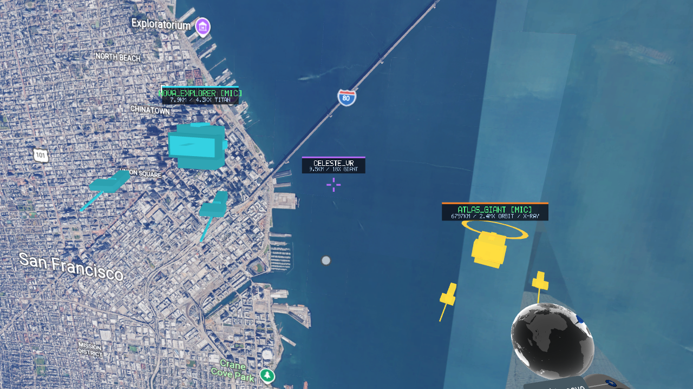
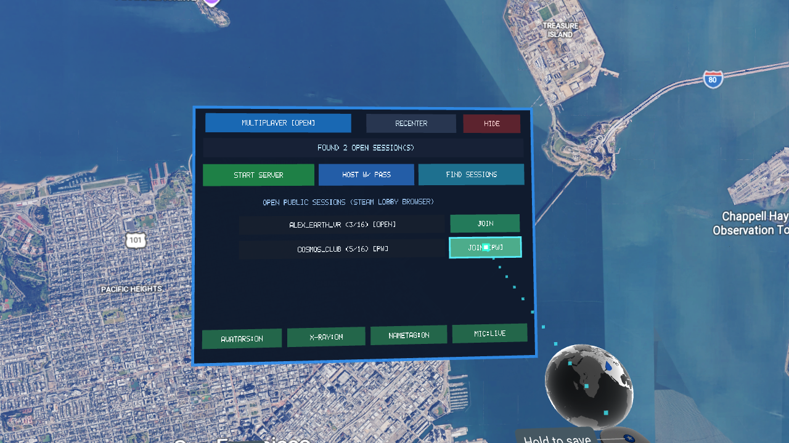
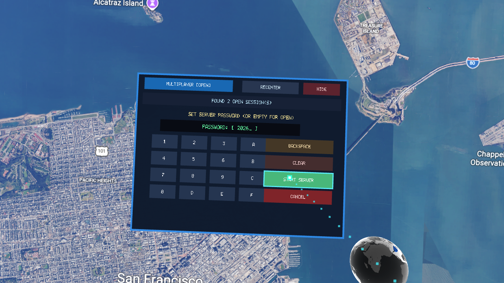
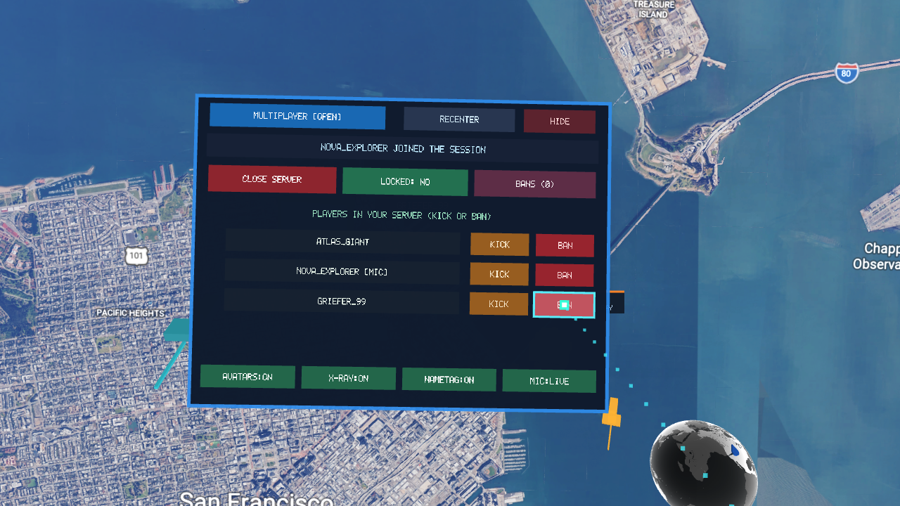
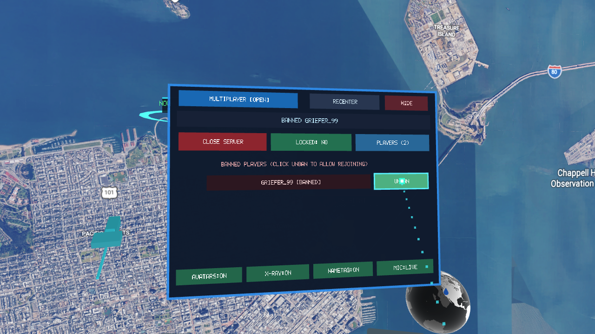
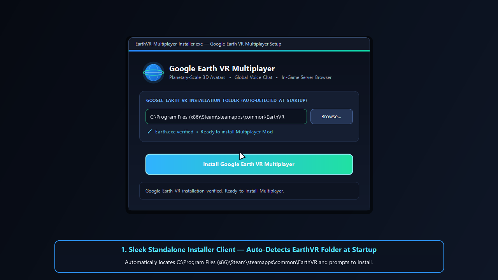

# Google Earth VR Multiplayer (`google-earth-vr-multiplayer`)

Real-time **6DoF VR Multiplayer**, **Global Voice Chat**, **X-Ray Planetary Vision**, and an **In-Game 3D VR Session & Moderation Menu** for **Google Earth VR** (`Earth.exe`).

[](https://github.com/YOUR_GITHUB_USER/google-earth-vr-multiplayer/releases)
[](https://store.steampowered.com/app/348250/Google_Earth_VR/)
[](LICENSE)

---

## Cinematic In-Game Trailer & Screenshots

🎬 **[Watch the Full 35-Second In-Game Showcase Trailer (`EarthVR_Multiplayer_Showcase.mp4`)](EarthVR_Multiplayer_Showcase.mp4)**

### Act I — The Player Experience: Multi-Scale Co-Op Flight, Global Voice Chat & X-Ray Vision

*Fly together over 3D San Francisco Bay: `Nova_Explorer` (`[MIC]`, cyan avatar with pulsing voice halo) glides alongside you at Titan scale ($4,696\times$), `Celeste_VR` (purple marker) explores the waterfront piers at city scale ($18\times$), and `Atlas_Giant` ($6,800\text{ km}$ away on the opposite side of the Earth) is visible right through the curvature of the planet via the holographic X-Ray shader.*

### Act II — In-Game 3D VR Menu, Session Browser, Password Keypad, Kick & Ban
| Public Session Browser (`[FIND SESSIONS]`) | 3D VR Password Keypad (`[HOST W/ PASS]`) |
| :---: | :---: |
|  |  |
| **Active Server: `[LOCKED]`, `[KICK]` & `[BAN]`** | **Persistent Ban List & `[UNBAN]`** |
|  |  |

---

## Key Features

### 1. True Planetary & Multi-Scale 6DoF Synchronization (`64-bit double` Keyhole Space)
- Hooks `Earth.exe`'s internal `vr::GeoWidgetImpl` / `TransformManager` (`Sim3d start_space_from_keyhole_space_`) and `CompositorImpl::RenderForeground`.
- Transforms your VR Headset (HMD) and both 6DoF VR hand controllers from local room-scale Start Space into Earth-Centered, Earth-Fixed **Keyhole Space** ($R_{\text{earth}} = 6,371,010\text{ m}$) in full 64-bit `double` precision.
- Converts remote friends from Keyhole Space into your local Start Space with exact relative scale:
  $$\text{scale}_{B \to A} = s_A \cdot \text{viewer\_scale}_B = \frac{\text{viewer\_scale}_B}{\text{viewer\_scale}_A}$$
- Whether a friend is human-sized ($1\times$) standing on a street corner, city-sized ($18\times$), or a giant ($1,000,000\times$) in orbit on the opposite side of the globe, their position, orientation, and size match their exact Earth-relative scale with zero 32-bit float jitter.

### 2. Always See Your Friends — Holographic X-Ray Vision Through the Earth
- Friends located behind the horizon or on the opposite side of the planet are automatically detected via analytical sphere-ray intersection (`IsOccludedByEarthSphere`) and rendered with a glowing holographic **X-Ray shader**, distance readout, and scale tag so you never lose track of your party.

### 3. Global Low-Latency Voice Chat
- Captures microphone audio (`16 kHz` mono low-latency IMA-ADPCM over Steam P2P & UDP) and mixes all connected friends at constant global volume regardless of planetary distance or viewer scale.
- Displays a real-time audio-reactive **Voice Halo** around speaking players' VR headsets and a live **`[MIC]`** indicator on their floating nametag.

### 4. In-Game 3D VR `MULTIPLAYER` Menu, Safety & Moderation
- **Public Session Browser (`[FIND SESSIONS]`)**: Discover open lobbies and LAN/Steam sessions with live player counts and `[OPEN]` / `[PW]` badges, and join with a single VR controller trigger click.
- **3D VR Password Keypad (`[HOST W/ PASS]`)**: Point and click with your VR controller laser to set or enter a session password, backed by salted **SHA-256 challenge-response authentication** and 64-bit session tokens.
- **Valve SDR Relay Privacy**: Automatically enables `k_nSteamNetworkingConfig_IP_AllowWithoutAuth = 0` so peer-to-peer traffic is routed through Valve's Steam Datagram Relay (SDR) network without exposing player IP addresses.
- **Session Lock (`[LOCKED: YES/NO]`)**: Lock an active session at any time to block new join requests while keeping current friends connected.
- **Separate `[KICK]` vs. `[BAN]` + `[UNBAN]`**:
  - **`[KICK]`**: Immediately disconnects a player from the current session without adding them to the ban list (they can rejoin or join future sessions).
  - **`[BAN]`**: Disconnects the player and records their 64-bit ID in the persistent ban list (`earthvr_mp_bans.txt`), blocking all future join attempts until unbanned.
  - **`[BANS (N)]` $\to$ `[UNBAN]`**: View banned players in-game and restore access with a single click.

---

## Quick Installation (1-Click Standalone Installer)



1. Download **`EarthVR_Multiplayer_Installer.exe`** from the [**Releases**](https://github.com/YOUR_GITHUB_USER/google-earth-vr-multiplayer/releases) page.
2. Launch **`EarthVR_Multiplayer_Installer.exe`**:
   - Automatically scans Windows Registry and all Steam library folders (`libraryfolders.vdf`) to locate your `Google Earth VR` (`Earth.exe`) directory.
   - Click **INSTALL MULTIPLAYER** to deploy `version.dll`, `steam_api64.dll`, `steam_appid.txt`, and `earthvr_mp.ini`.
   - Re-running the installer when already installed provides one-click **REINSTALL / UPDATE** and **UNINSTALL MOD** buttons.

### VR Controls & Desktop Hotkeys
- **VR Controller Menu Button** (or **`TAB`** / **`F4`** on keyboard): Open/close the floating 3D VR `MULTIPLAYER` menu in front of your headset.
- **VR Controller Trigger** (or **Left Mouse Click**): Click buttons on the 3D VR menu with the laser pointer.
- **`F5`**: Toggle 3D VR Avatars
- **`F6`**: Toggle X-Ray Vision Through Earth
- **`F7`**: Toggle Floating Nametags & Distance Markers
- **`F9`**: Toggle Microphone Mute

---

## Building from Source

### Prerequisites
- Windows 10/11 x64
- Visual Studio 2022 or 2026 (MSVC C++17 toolset)

### Build & Run Verification Suite
```bat
build.bat
```
Running `build.bat` performs 5 automated steps:
1. Compiles `build\version.dll` (the proxy DLL & OpenGL 3.3 / OpenVR hook).
2. Compiles `build\test_multiplayer.exe`.
3. Runs the automated verification suite (64-bit Keyhole transforms, IMA-ADPCM voice SNR, SHA-256 password authentication, anti-spoofing, session lock, separate kick vs. ban, and unban verification).
4. Packs `version.dll` and `steam_api64.dll` into `installer\embedded_payload.h`.
5. Compiles `EarthVR_Multiplayer_Installer.exe` (`build\EarthVR_Multiplayer_Installer.exe`) and runs `--self-test`.

---

## License

Released under the [MIT License](LICENSE).
